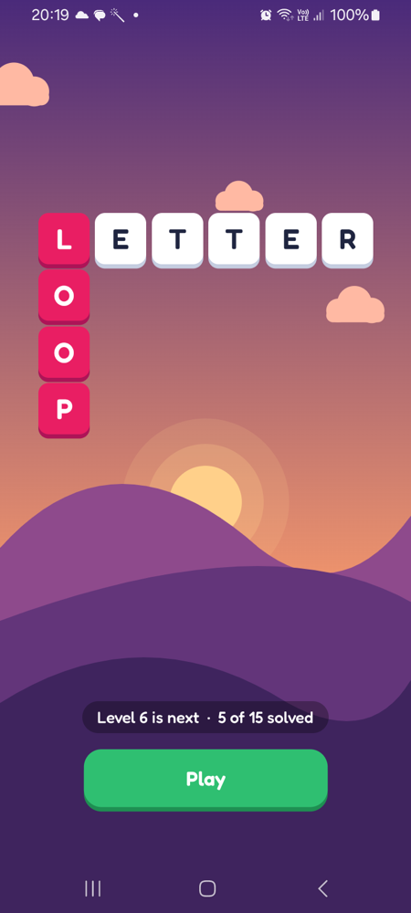
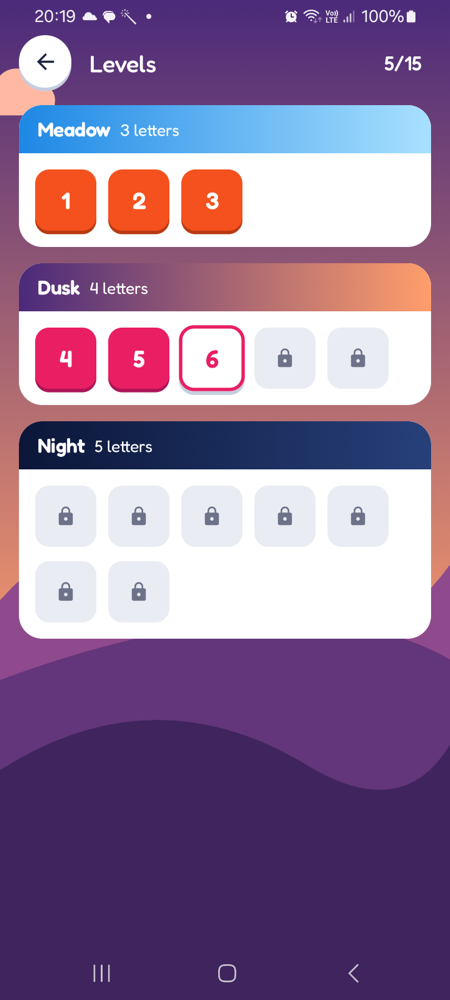
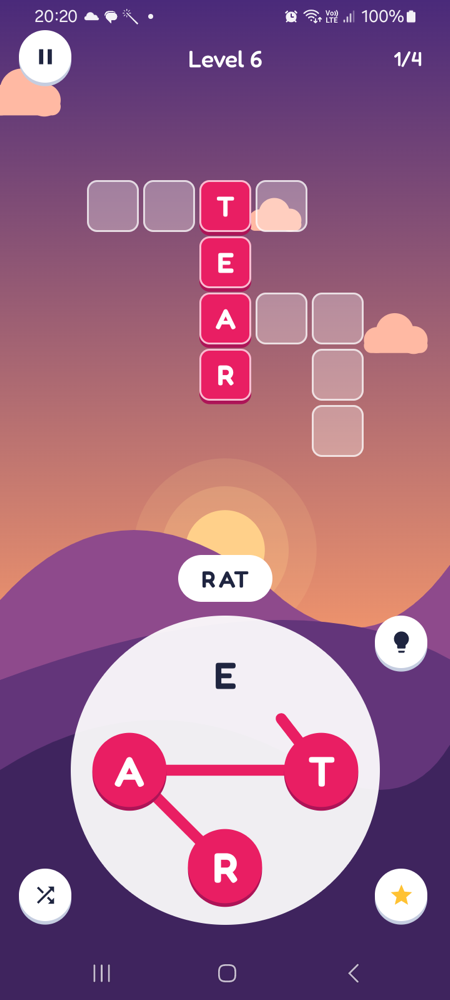
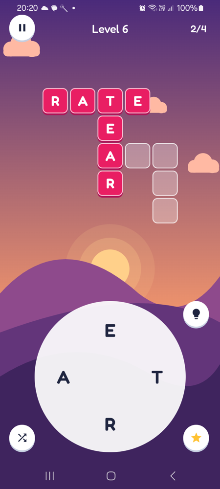

# LetterLoop

A word puzzle game for Android. A crossword grid sits at the top of the screen and a wheel of
3–5 letters at the bottom. Drag one finger across the wheel letters to spell a word: grid words
fill into the crossword, extra real words count as bonus words, and when the grid is full the
game moves on to the next level by itself. There are 15 levels.

The mechanics follow the brief's reference game; the name, look, colours and all level content
are original.

<p>
  
  
  
  
</p>

- **Play it:** install [`release/LetterLoop.apk`](release/LetterLoop.apk) (Android 7.0+, API 24).
- **Design brief and decision log:** [`development.md`](development.md), section 13 explains every
  non-obvious choice.

---

## Install and build

Install the ready-made APK on a phone with USB debugging on:

```bash
adb install release/LetterLoop.apk
```

The release APK is an **assessment build, signed with the Android debug key** so it installs
straight from the file. A store build would be signed with its own upload key.

Build from source (Android Studio with AGP 9.5, or the Gradle wrapper; the Gradle daemon
provisions its own JDK through the foojay toolchain resolver):

```bash
./gradlew :app:assembleDebug        # debug APK
./gradlew :app:installDebug         # install debug on a connected phone
./gradlew :app:assembleRelease      # R8-shrunk release APK, app/build/outputs/apk/release/
```

Play the release build: Compose debug builds are visibly less smooth.

---

## Architecture: MVVM with one-way data flow

One Activity, Jetpack Compose, three layers. Dependencies only point downward.

```
ui/          Composables. Draw state, forward user actions. No game rules.
  │  collects StateFlow<UiState>, calls named ViewModel functions
ViewModel    Holds one immutable UiState per screen, calls the engine, saves progress.
  │
game/        Pure Kotlin rules (no Android imports). Unit tested.
data/        Levels from assets/levels.json, progress in DataStore. Behind interfaces.
```

```
LetterLoopApp / AppContainer   Manual dependency wiring (no DI framework)
game/       Level, GameState, GameEngine (submit, hint, completion), LevelValidator
data/       LevelRepository (+ parseLevels), ProgressRepository (DataStore), LevelProgress
ui/navigation  Routes, NavHost and the navigation guard
ui/home, ui/levels, ui/game    Screens and their ViewModels
ui/components  Scenery (Scene.kt), buttons, keycap edge
ui/theme       Colour tokens, Fredoka typography
```

**Why MVVM:** the brief asks for MVVM or MVI. A single immutable `UiState` per screen, exposed
as a `StateFlow` and changed only through named functions (`onWordSubmitted`, `onHint`,
`onShuffle`, `onFeedbackShown`), gives MVI's predictability without reducer and intent
boilerplate for three screens. ViewModels never hold a `Context`, `Activity`, `NavController` or
composable lambda, and every coroutine runs in `viewModelScope` or a composable effect scope.

---

## How the swipe gesture works

The most important code is in `ui/game/WheelGeometry.kt` (pure maths) and
`ui/game/LetterWheel.kt` (the composable).

**Geometry.** Letters sit evenly on a circle at 0.62 × the wheel radius, the first at the top,
then clockwise. A letter is "hit" within 0.25 × the wheel radius of its centre. That is below
half the distance between neighbours on a 5-letter wheel (0.62 · sin 36° ≈ 0.364), so one point
can never hit two letters.

**Segments, not points.** A fast finger moves further than one letter between two touch samples,
so checking only where the finger *is* would skip letters. For every move event the wheel walks
the event's historical touch samples and then its current position, and treats each step as a
line segment. For each letter it projects the centre onto the segment
(`t = ((c − a) · d) / |d|²`), clamps `t` to the segment, and checks whether that closest point is
within the hit radius. Hits are handled in order of `t`, the order the finger reaches them.

**Selection rule** (`nextSelection`, by letter *index*, so a wheel with two O's works):
- a letter not yet selected is added (with a light haptic tick);
- the second-to-last selected letter means the finger went back: the last letter is removed;
- anything else changes nothing. Backtracking stops at one letter.

**One finger, clean endings.** `pointerInput` + `awaitEachGesture` remembers the pointer id of
the first finger and ignores the rest. On lift, 2+ letters are submitted. When Android cancels
the gesture, Compose delivers a lift that is already consumed; that is how a cancel is told apart
from a real lift, and nothing is submitted. A `finally` block clears the selection on lift,
cancel, or when the gesture is restarted (the `pointerInput` is keyed on the letters and the
enabled flag, so a shuffle or the level-complete celebration cancels a swipe in progress).

**Drawing.** The finger position lives in a state object read *only* inside the `Canvas` draw
lambda, so a touch move is a redraw, never a recomposition, and the line stays glued to the
finger. The line is a `Path` in the chapter's accent colour through the selected letters to the finger, not animated.

The ViewModel only ever hears about finished words; the in-progress selection is short-lived UI
state that stays in the composable.

---

## Level data and validation

Levels live in [`app/src/main/assets/levels.json`](app/src/main/assets/levels.json):

```json
{ "id": 4, "letters": "STOP",
  "words": [ { "word": "STOP", "row": 0, "col": 0, "dir": "ACROSS" },
             { "word": "POTS", "row": 0, "col": 3, "dir": "DOWN" },
             { "word": "TOPS", "row": 3, "col": 0, "dir": "ACROSS" } ],
  "bonus": ["POST", "SPOT", "OPTS", "POT", "TOP", "OPT", "SOP"] }
```

`letters` are the wheel letters (they may repeat); `words` are the grid words with the cell of
their first letter; `bonus` lists the extra real words the letters make. There is no dictionary:
a swipe counts only if it is a grid word or a listed bonus word. Grid size is computed from the
words. Levels 1–3 use 3 letters, 4–8 use 4, 9–15 use 5, with 2 rising to 6 grid words.

`parseLevels()` is a pure function (kotlinx.serialization, unknown fields ignored, malformed JSON
or an unknown direction throws). `LevelValidator` enforces eight rules: 3–5 upper-case letters;
every word ≥ 3 letters and spellable from the wheel (respecting how many times a letter
appears); crossing cells agree; all grid words connected; every run of 2+ letters is exactly one
declared word; no duplicates; grid at most 7 × 7; ids 1..15 in order. `LevelsValidationTest`
runs it over the real file, proves every level is solvable through the engine, and prints a
broken level as an ASCII grid.

---

## How state survives rotation and process death

| State | Where | Rotation | Process death |
|---|---|---|---|
| Found words, bonus words, hinted cells | DataStore `progress_<id>` (JSON), written after every accepted word or hint | yes | yes |
| Highest unlocked level | DataStore `highest_unlocked`, never decreases, clamped to 1..16 | yes | yes |
| Level being played | `SavedStateHandle["currentLevelId"]`, seeded from the route | yes | yes |
| Shuffled wheel order | `SavedStateHandle` | yes | yes |
| Pause dialog open | The Navigation back stack (Pause is a dialog destination) | yes | yes |
| Letters selected mid-swipe | Local composable state | no, by design | no, by design |

- **Rotation** keeps the ViewModels; the UI simply redraws the same `UiState`. Grid tiles start
  their animation from their current state, so nothing re-animates. One-shot feedback carries an
  increasing id and is cleared once shown, so it is not replayed.
- **Process death** rebuilds the back stack (including an open Pause) from saved state, and the
  ViewModel reloads progress from DataStore. Saved data is never trusted blindly: unreadable
  values or words that do not belong to the level start the level fresh.
- **Mid-swipe selection is deliberately not saved:** a rotation cancels the touch gesture anyway,
  so there is nothing meaningful to restore.
- **Next level without navigation:** the ViewModel swaps the level in place, so the back stack
  stays Home → Level Select → Game however many levels are played.
- **The celebration countdown only runs while the game is on screen.** Android saves state when
  the app goes to the background; advancing behind the player's back would make that saved state
  stale, and a kill would bring back a level whose progress was already cleared. Paused, the
  saved state stays true: a kill during the celebration restores the "complete" card, which then
  moves on.

**Navigation rules:** every navigation call is ignored unless the screen asking is the top,
RESUMED entry (and uses `launchSingleTop`), which makes double taps and taps during a transition
harmless. Pause pops back to existing entries; it never navigates forward to Home or Level Select.

---

## Look and animation

The scenery behind every screen (sky, sun or moon, clouds or stars, hills) is drawn in code on a
`Canvas`; there are no image files. Levels fall into three chapters by wheel size, read from the
level data: Meadow (3 letters), Dusk (4) and Night (5). Each chapter has its own scenery and one
accent colour for found words, selected letters and the swipe line.

The scenery is a single layer behind the `NavHost`, so it stays still while screens change on top
of it. Screens "fade through": the old content fades out, then the new content fades in with a
small scale. Other motion: the logo drops in tile by tile, the Play button and the current level
pulse, found tiles pop in one after another, a bonus word flies to the bonus button, an invalid
word shakes, shuffled letters glide, and confetti falls when a level is complete. Every animated
value is read in the draw or layer phase, so a frame is a redraw and not a recomposition.

---

## Testing

```bash
./gradlew :app:testDebugUnitTest            # JVM tests
./gradlew :app:connectedDebugAndroidTest    # device tests, needs an emulator or phone
```

Final counts: **95 JVM tests and 21 device tests, all passing** (device: Samsung SM-A047F,
Android 14).

| Class | Kind | Covers |
|---|---|---|
| `GameEngineTest` (16) | JVM | submit / hint rules, completion, immutability |
| `LevelValidatorTest` (16) | JVM | each of the 8 rules rejects a broken level |
| `LevelsValidationTest` (5) | JVM | the real `levels.json`: valid, solvable, ramp |
| `LevelParsingTest` (5) | JVM | JSON parsing and bad input |
| `WheelGeometryTest` (10) | JVM | letter placement, segment hit testing, fast-swipe case |
| `WheelSelectionTest` (8) | JVM | selection and backtracking rule, repeated letters |
| `GameViewModelTest` (23) | JVM | feedback, saving, celebration in virtual time, restore, shuffle, hint |
| `LevelSelectViewModelTest` (5) | JVM | locked / current / completed, live updates |
| `ProgressRepositoryTest` (7) | JVM | real DataStore on a temp file, corrupt values |
| `LetterWheelGestureTest` (9) | device | slow, jumping, backtracking, cancelled, two-finger and 20 rapid swipes |
| `NavigationTest` (9) | device | back stack, double taps, locked level, three levels in a row |
| `StateRestorationTest` (3) | device | found word, Pause and shuffle survive `recreate()` |

Repositories use hand-written fakes; there is no mocking library. Real process death cannot be
produced inside a test, so it was checked by hand (`adb shell am kill` while in the background,
then reopening from recents), along with "Don't keep activities", force-stop and a 360×640dp
screen in both orientations. See the checklist in `development.md` section 11.

---

## Deliberately left out

- Sound, coins or any currency, ads, analytics, daily puzzles and a settings screen (out of scope).
- A dictionary: bonus words are listed per level, keeping the APK small and results deterministic.
- Generated or endless levels: the 15 levels are written by hand. The production route would be a
  bundled open word list and an on-device generator whose output is checked by `LevelValidator`.
- Light/dark switching and wallpaper-based colours: the game looks the same on every device.
- Saving the in-progress swipe (see above).
- Hilt/Koin, Room, MVI frameworks, multiple modules: two repositories and three screens do not
  need them.

---

## Credits and licences

- Font: **Fredoka** by The Fredoka Project Authors, SIL Open Font License 1.1, bundled in
  `app/src/main/res/font`; licence text in [`licenses/Fredoka-OFL.txt`](licenses/Fredoka-OFL.txt).
- Icons: paths from **Material Design icons** by Google, Apache License 2.0, as vector drawables
  in `app/src/main/res/drawable`.
